# Autenticação

> Status: cadastro, login, recuperação de senha e duração de sessões concluídos
> Última atualização: 14 de novembro de 2026

## Visão geral

A aplicação aceita duas formas de login, mas ambas terminam na mesma sessão local:

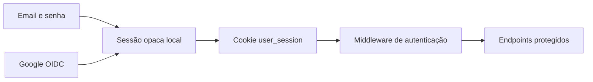

A aplicação não emite JWT próprio. O ID token do Google é usado somente para comprovar a identidade durante o callback. Depois disso, Google e senha usam `user_sessions` no PostgreSQL.

## Modelo de conta

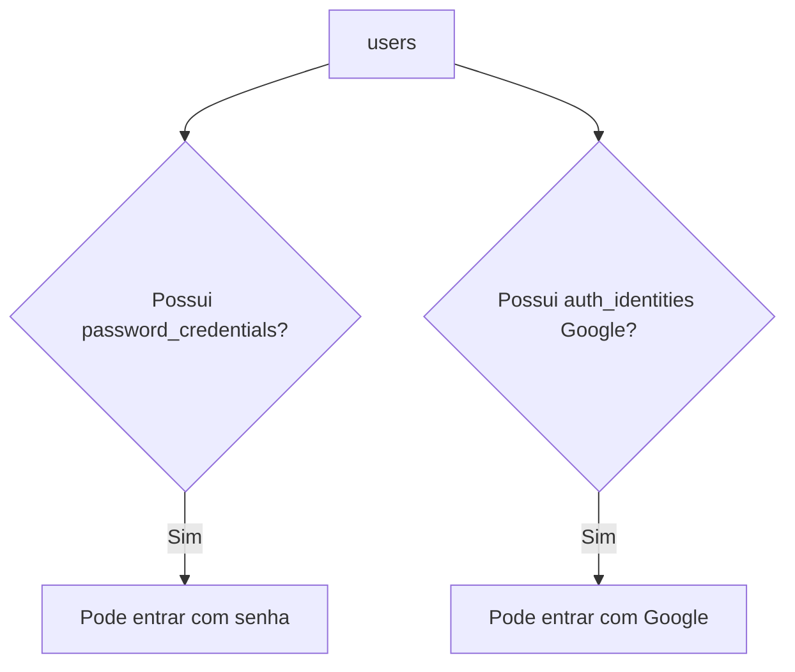

Um usuário pode ser:

| Tipo de conta | `password_credentials` | `auth_identities` |
|---|---:|---:|
| Somente senha | Sim | Não |
| Somente Google | Não | Sim |
| Senha vinculada ao Google | Sim | Sim |

Uma conta criada originalmente pelo Google não pode adicionar ou recuperar senha no MVP. Uma conta confirmada por senha pode ser vinculada automaticamente ao Google quando o Google comprova o mesmo email.

## Cadastro com senha ✅

O cadastro recebe email, senha e nome completo, e não cria imediatamente uma linha em `users`. Primeiro existe uma tentativa temporária, que também guarda o nome.

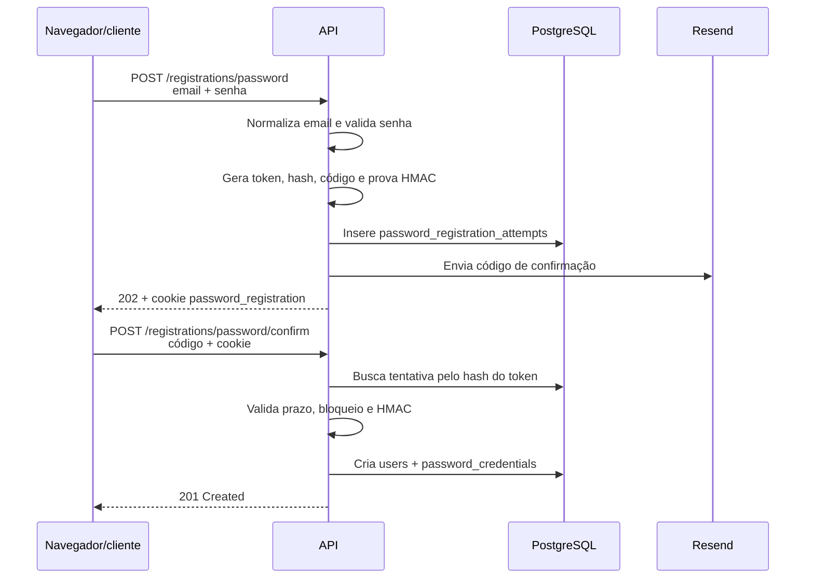

### Por que existe um token e um código?

- O token identifica a tentativa específica e fica em cookie `HttpOnly`; somente seu SHA-256 é armazenado.
- O código chega por email e prova que a pessoa controla aquele endereço.
- A prova armazenada é `HMAC(token, código)`. O código puro não fica no banco.

### Prazos e proteção contra abuso

- código: 10 minutos por padrão;
- tentativa inteira: 30 minutos por padrão;
- reenvio: cooldown de 30 segundos;
- erro de código: espera de 30 segundos;
- a cada cinco erros: bloqueio de cinco minutos;
- reenvio gera outro código sem prolongar o prazo total da tentativa;
- job periódico remove tentativas expiradas ou cujo email já virou usuário.

## Login com senha ✅

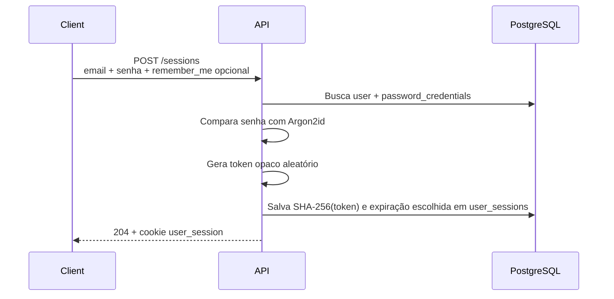

Email inexistente e senha incorreta retornam a mesma mensagem pública. Isso reduz enumeração de contas.

## Login com Google ✅

O fluxo usa OAuth 2.0 Authorization Code Flow com OpenID Connect, PKCE, `state` e `nonce`.

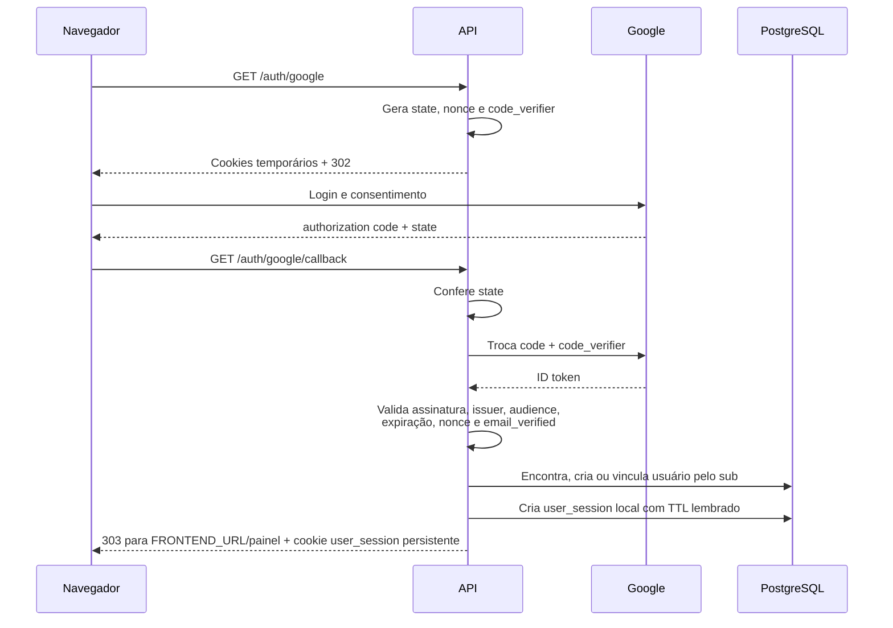

Qualquer falha no callback (recusa, cookies ausentes, state diferente, erro do Google ou interno) redireciona para `FRONTEND_URL/entrar?erro=google`, sem criar sessão. O destino é fixo e vem só da configuração; `FRONTEND_URL` precisa ser uma origem sem caminho nem query, para o callback não virar open redirect.

### Regra de localização e vinculação

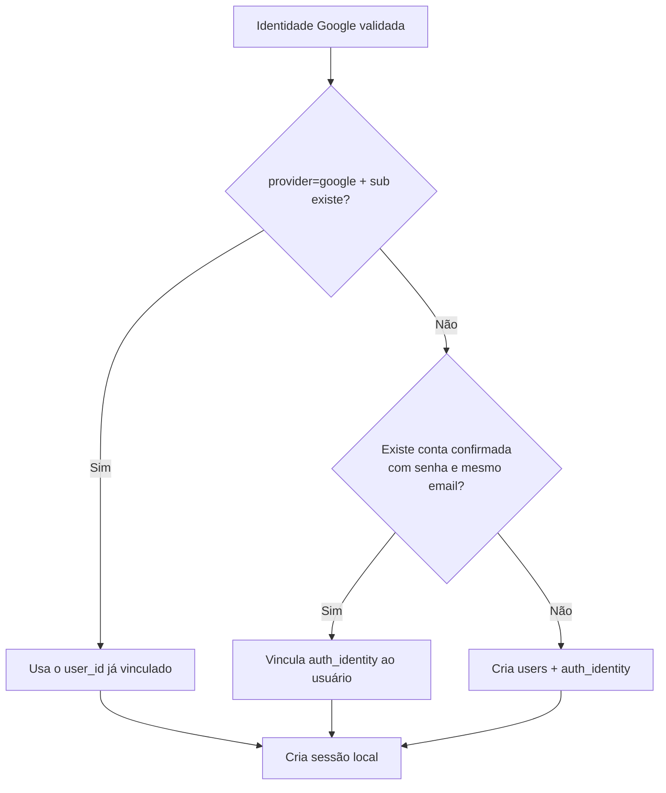

O `sub` é o identificador estável da conta dentro do Google. Depois que ele é vinculado, o login encontra o usuário pelo `sub`, não pelo email retornado em logins posteriores.

## Sessão opaca ✅

O cookie contém o token puro; o banco contém apenas o hash.

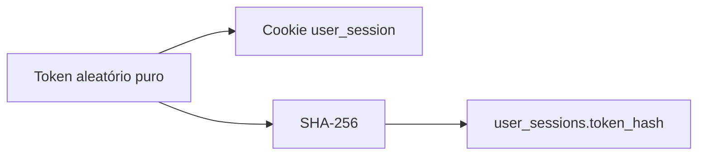

Configuração atual do cookie:

| Atributo | Valor |
|---|---|
| Nome | `user_session` |
| `HttpOnly` | Sim |
| `Secure` | Configurável; `false` somente no HTTP local |
| `SameSite` | `Lax` |
| `Path` | `/` |

`HttpOnly` impede JavaScript da página de ler diretamente o token, mas não substitui proteção contra XSS. Um script malicioso ainda pode realizar requests em nome do usuário enquanto estiver executando na página.

## Autenticação de requests ✅

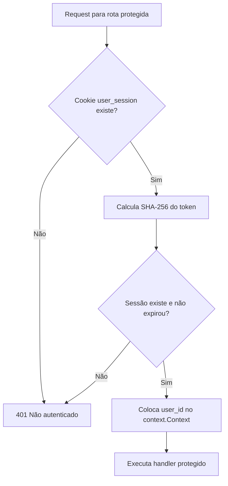

O handler protegido usa o `user_id` do contexto. Ele nunca aceita que o cliente escolha a identidade por query, header ou body.

## Conta: `GET /me`, nome e troca de senha ✅

`GET /me` comprova que a sessão está válida e retorna a conta autenticada, com o nome completo e como ela entra:

```json
{
  "id": "019...",
  "email": "usuario@example.com",
  "full_name": "Ana Souza",
  "has_password": true,
  "has_google": false,
  "created_at": "2026-11-14T12:00:00Z"
}
```

### Nome completo

O cadastro com senha exige `full_name`, guardado na tentativa e copiado para `users` na confirmação. O login com Google pede o escopo `profile` e usa o claim `name` para preencher o nome **só quando a conta ainda não tem um**, então um nome editado pela pessoa nunca é sobrescrito. `PATCH /me` altera o nome. Em todos os casos o nome é normalizado (espaços das pontas removidos, espaços repetidos juntados), tem de 1 a 100 caracteres e não aceita caracteres de controle ou invisíveis.

### Troca de senha

`POST /me/password` segue o [OWASP Authentication Cheat Sheet](https://cheatsheetseries.owasp.org/cheatsheets/Authentication_Cheat_Sheet.html) e o [Session Management Cheat Sheet](https://cheatsheetseries.owasp.org/cheatsheets/Session_Management_Cheat_Sheet.html):

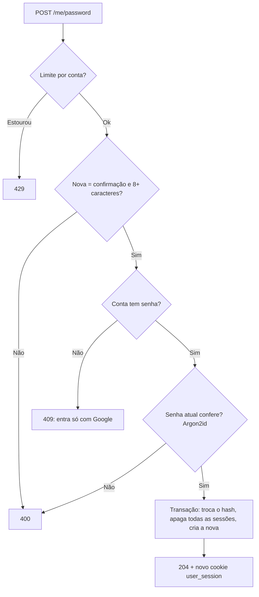

- A **senha atual é obrigatória**, porque uma sessão roubada não deve bastar para trocar a senha.
- O **limite é por conta** (5 seguidas, depois 5 a cada 15 minutos) e vem antes da comparação Argon2id.
- **Todas as sessões são encerradas** e este navegador recebe um **ID de sessão novo** com o mesmo prazo do anterior; quem estiver logado em outro aparelho precisa entrar de novo.
- A nova senha não pode ser igual à atual.

A nova senha segue a mesma regra do cadastro e da recuperação: pelo menos 8 caracteres, com ao menos uma letra maiúscula, um número e um caractere especial. A composição é uma decisão de produto contra a recomendação do NIST SP 800-63B, registrada no [ADR 0004](decisions/0004-account-password-composition.md).

## Logout ✅

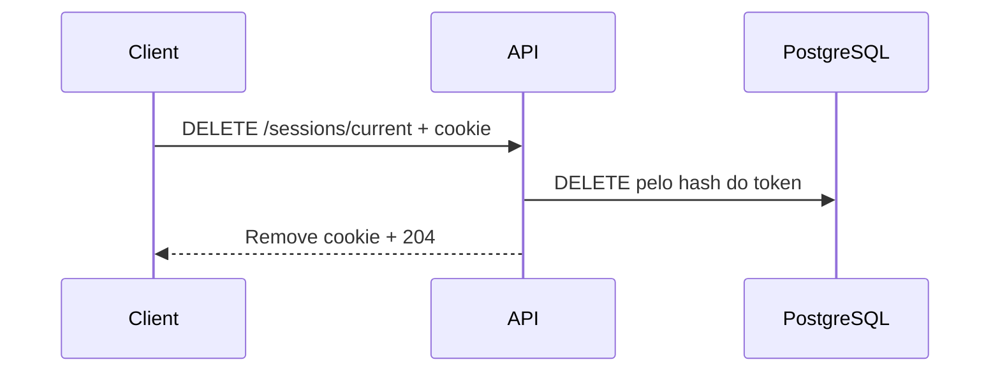

O logout é idempotente: sem cookie, token desconhecido ou chamada repetida continuam retornando `204`.

## Recuperação de senha ✅

O início e a confirmação da recuperação estão implementados. A troca da senha, o consumo do código e a revogação das sessões anteriores ocorrem na mesma transação. O usuário precisa fazer login novamente.

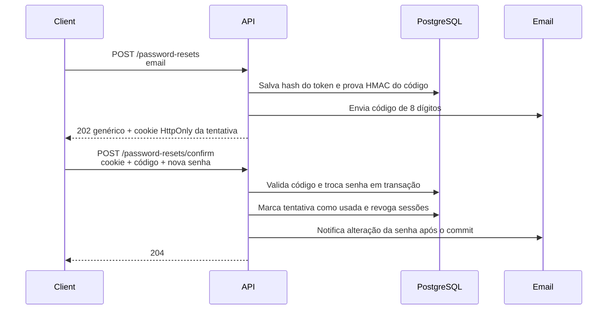

Email inexistente, conta Google-only e conta com senha têm a mesma resposta externa no pedido de recuperação. Erros reais de infraestrutura continuam sendo `500`. Falha da notificação posterior não desfaz a senha já alterada.

## “Lembrar de mim” ✅

É a mesma sessão opaca com duas políticas de duração no login por senha:

```text
remember_me ausente/false → 12h por padrão no banco + cookie de sessão sem Expires/Max-Age
remember_me=true         → 30 dias por padrão no banco + cookie persistente
```

O login Google usa a política lembrada por padrão, sem checkbox ou parâmetro `remember_me` no fluxo OAuth. O cookie guarda o token nos dois casos; apenas sua persistência no navegador muda. Fechar o navegador normalmente remove o cookie de sessão, mas a restauração de sessão pode preservá-lo. O servidor sempre rejeita a sessão depois de `user_sessions.expires_at`.

Não há token em `localStorage`, JWT próprio ou expiração deslizante no MVP.

## Inventário de códigos e tokens

| Valor | Objetivo | Viaja puro onde? | Persistência |
|---|---|---|---|
| Código de confirmação | Provar controle do email | Email e body de confirmação | Somente prova HMAC |
| Token de cadastro | Identificar tentativa | Cookie `password_registration` | SHA-256 |
| OAuth `state` | Ligar início e callback | Cookie e query do callback | Não persistido |
| OIDC `nonce` | Ligar tentativa ao ID token | Cookie e claim assinado | Não persistido |
| PKCE `code_verifier` | Provar quem iniciou a troca | Cookie e request backend→Google | Não persistido |
| Authorization code | Autorizar uma troca por tokens | Query do callback | Não persistido |
| ID token | Comprovar identidade Google | Google→backend | Validado e descartado |
| Session token | Autenticar na ShortBit | Cookie `user_session` | SHA-256 |
| Password reset token | Identificar tentativa e compor a prova HMAC | Cookie HttpOnly | SHA-256 |
