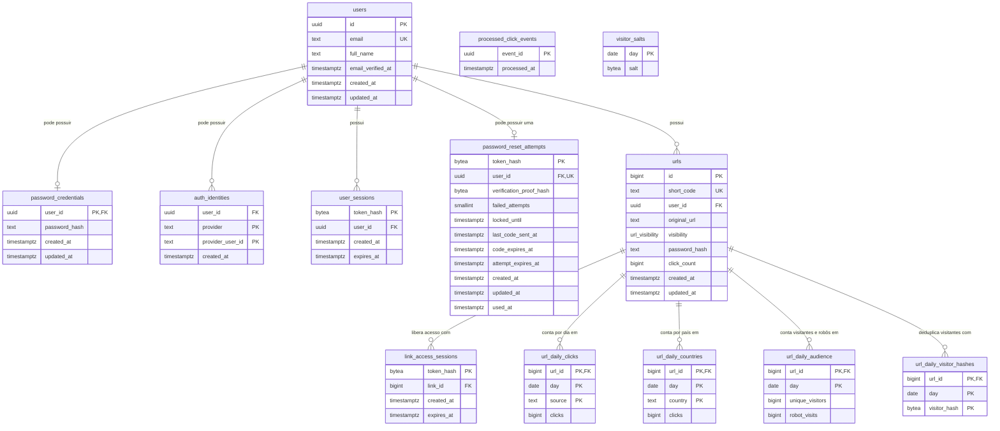
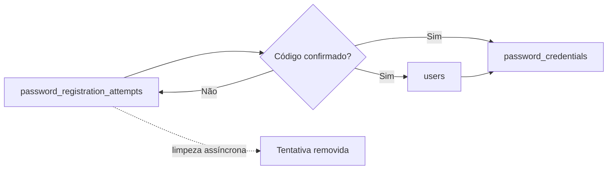
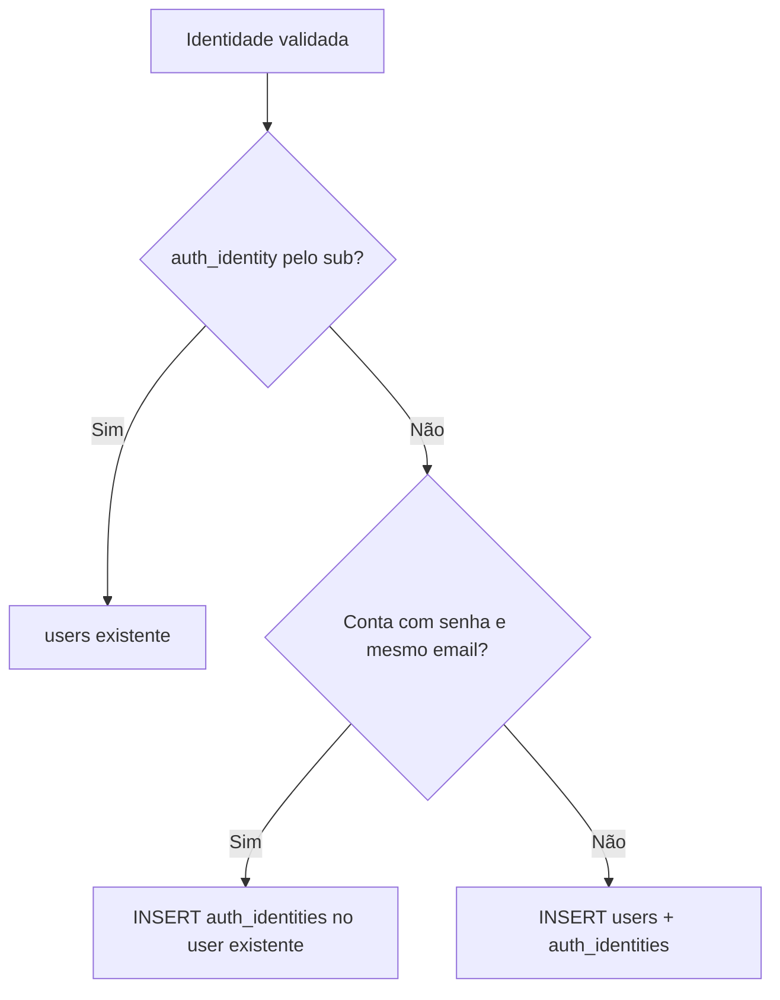
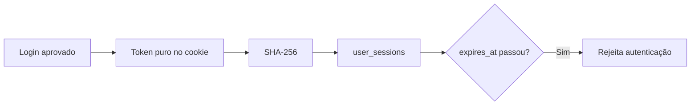

# Modelo de dados

> Status: migrations `00001` a `00010`
> Última atualização: 16 de novembro de 2026

PostgreSQL é a fonte da verdade. Tokens secretos são armazenados somente como hash.

## Diagrama



`password_registration_attempts` não aponta para `users`, pois representa um cadastro que ainda não virou conta. `processed_click_events` não aponta para `urls`: guarda só o `event_id` para deduplicação.

## Ciclo de vida das contas

### Cadastro por senha



### Primeiro login Google



### Sessão



## Tabelas

### `users`

Identidade local principal. Usa UUIDv7, email canônico e email obrigatoriamente confirmado. `full_name` (migration `00008`) é opcional no banco porque contas antigas não têm nome; quando presente, não pode ser vazio e tem até 100 caracteres. O cadastro com senha sempre envia o nome, e o login com Google o preenche quando falta. `password_registration_attempts.full_name` guarda o nome até a confirmação.

### `password_credentials`

Existe somente para contas capazes de entrar por senha. O hash usa Argon2id. Separar credencial de `users` permite contas Google-only sem coluna de senha nula ou artificial.

### `auth_identities`

Guarda identidades externas. Para Google:

```text
provider = google
provider_user_id = claim sub
```

A chave `(provider, provider_user_id)` identifica a conta externa. A constraint `(user_id, provider)` impede vincular duas contas do mesmo provedor ao mesmo usuário.

### `password_registration_attempts`

Guarda temporariamente cadastro ainda não confirmado, incluindo password hash, prova HMAC do código, cooldowns e prazos. Não concede autenticação.

### `user_sessions`

Guarda o hash de tokens opacos. O token puro só fica no cookie do cliente.

### `password_reset_attempts`

Há no máximo uma linha por usuário com senha. O token opaco fica no cookie e seu hash identifica a tentativa; `verification_proof_hash` guarda HMAC(token, código), nunca o código puro. O upsert respeita cooldown e bloqueio, troca o código sem estender a vida da tentativa ativa e reinicia os contadores apenas após a expiração. `used_at` impede reutilização após a confirmação.

### `urls` ✅

O schema e os fluxos HTTP de criação, listagem, consulta individual e redirects público/privado estão implementados. Links privados exigem `password_hash`; links públicos exigem que esse campo seja `NULL`. URLs criadas não expiram automaticamente; a expiração de `link_access_sessions` limita apenas o acesso temporário a um link privado (30 minutos por padrão, configurável).

`id` é `BIGINT GENERATED ALWAYS AS IDENTITY`; `short_code` é derivado do ID com Sqids e `MinLength: 6`, persistido e protegido por `UNIQUE`. A migration exige **no mínimo seis caracteres, sem máximo fixo**. O redirect consulta `short_code` diretamente, sem decodificá-lo. `click_count` é incrementado pelo worker de cliques, ou pelo fallback síncrono, com deduplicação em `processed_click_events`. Consulte [Links e shortcodes](short-links.md) para configuração, limites reais e fluxo de criação.

### `link_access_sessions` 📋

Sessão temporária e específica de um link privado. Não substitui `user_sessions` e não autentica uma conta.

### `processed_click_events` ✅

Tabela de deduplicação do worker de cliques ([ADR 0002](decisions/0002-click-events-rabbitmq-redis-cache.md)). Na mesma transação, o worker insere o `event_id` com `ON CONFLICT DO NOTHING` e, só se a linha foi inserida, incrementa `urls.click_count`. Uma reentrega do mesmo evento não insere nada e não conta de novo. Um evento para uma URL inexistente desfaz a transação e não é registrado.

O worker apaga eventos com `processed_at` mais antigo que `PROCESSED_CLICK_EVENT_RETENTION` (7 dias por padrão), a cada hora; o índice em `processed_at` atende essa limpeza.

### `url_daily_clicks` ✅

Cliques de cada link por dia e por origem: `link` (alguém abriu o link curto) ou `qr` (alguém leu o QR code, que leva `?qr=1`). O dia é a data do clique em `America/Sao_Paulo`. Só existem linhas para dias com clique; a API completa os outros com zero. O worker e o fallback somam aqui na mesma transação de `processed_click_events` e `urls.click_count`, então reentregas não contam de novo ([ADR 0005](decisions/0005-daily-clicks-and-qr-source.md)). Apagar a URL apaga as linhas (`ON DELETE CASCADE`).

### `url_daily_countries` ✅

Cliques de pessoas por link, dia e país (código ISO de duas letras), vindo da base IP→país local ([ADR 0007](decisions/0007-country-unique-visitors-robots.md)). Cliques sem país conhecido não têm linha: são a diferença para `url_daily_clicks`, calculada pela API. Robôs não entram.

### `url_daily_audience` ✅

Por link e dia: `unique_visitors` (pessoas diferentes, pelo hash do dia) e `robot_visits` (robôs de prévia e buscadores, que ficam fora de `click_count`, `url_daily_clicks` e dos países). Os únicos são por dia: a soma de um período conta de novo quem voltou em outro dia.

### `url_daily_visitor_hashes` ✅

Visitantes já contados num link num dia: `HMAC-SHA256(sal do dia, url_id ‖ IP ‖ User-Agent)` truncado em 16 bytes, calculado pela API. O worker insere com `ON CONFLICT DO NOTHING` e só soma em `unique_visitors` se a linha entrou, na mesma transação de `processed_click_events`. O job horário do worker apaga os dias anteriores a ontem.

### `visitor_salts` ✅

Um sal aleatório de 32 bytes por dia de `America/Sao_Paulo`, criado pela primeira instância da API que precisa dele. O job horário do worker apaga os sais de dias passados; sem o sal, um hash guardado não pode ser refeito a partir de um IP.

## Regras de exclusão

| Relação | Comportamento |
|---|---|
| Usuário → credenciais/identidades/sessões/reset | `ON DELETE CASCADE` |
| Usuário → URLs | `ON DELETE RESTRICT` |
| URL → sessões de acesso | `ON DELETE CASCADE` |
| URL → cliques por dia | `ON DELETE CASCADE` |
| URL → países, visitantes e robôs por dia | `ON DELETE CASCADE` |

Não existe endpoint de exclusão de conta no MVP; essas regras protegem consistência futura.
